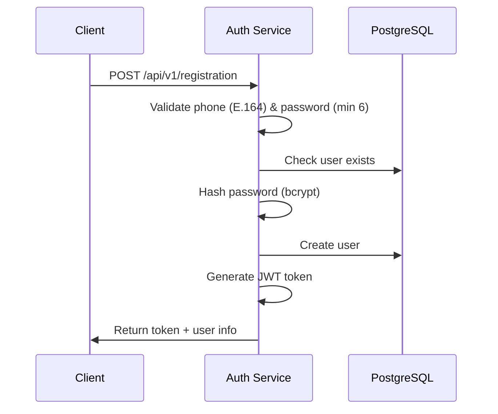

# Архитектура LUNARY - Production Ready

## 🎯 Обзор

LUNARY построен на микросервисной архитектуре с акцентом на **production-ready** решения. Каждый сервис отвечает за определённую функциональность, имеет собственную базу данных и может развиваться независимо.

## ✅ Production-Ready Features

### Уже реализовано:
- **✅ Unit Testing** - полное покрытие бизнес-логики с go-sqlmock
- **✅ Structured Logging** - JSON логи с метаданными (Logrus)
- **✅ Health Checks** - liveness, readiness, detailed monitoring
- **✅ Graceful Shutdown** - корректное завершение с cleanup функциями
- **✅ Error Handling** - структурированные ошибки с HTTP статусами
- **✅ Request Validation** - go-playground/validator с кастомными сообщениями
- **✅ API Documentation** - Swagger/OpenAPI спецификация
- **✅ Containerization** - Docker + Kubernetes готовность

## 🏗️ Компоненты системы

### 1. Auth Service (8081) ✅ **Production Ready**

**Функциональность:**
- Регистрация пользователей с валидацией телефона (E.164)
- Авторизация с JWT токенами и bcrypt хешированием
- Структурированное логирование всех auth событий
- Health checks с мониторингом БД соединений
- Graceful shutdown с 30s timeout

**Endpoints:**
```
POST /api/v1/registration  - Регистрация пользователя
POST /api/v1/login         - Авторизация
GET  /health               - Детальная диагностика
GET  /health/live          - Liveness probe
GET  /health/ready         - Readiness probe
GET  /swagger/             - API документация
```

**Production Features:**
- **Tests**: Service + Handler layers с go-sqlmock
- **Validation**: Phone (E.164), password (min 6 chars), email
- **Errors**: VALIDATION_ERROR, AUTH_ERROR, CONFLICT_ERROR, INTERNAL_ERROR
- **Logging**: AuthEvent, HTTPRequest, DBOperation логи
- **Health**: Database connection monitoring с метриками
- **Shutdown**: Database cleanup, active connections wait

### 2. Scenario Service (8082) ✅ **Production Ready**

**Функциональность:**
- CRUD операции со сценариями
- Feedback система с рейтингами 1-5
- Поэтапное выполнение сценариев
- Database migrations с seed data

**Endpoints:**
```
GET  /api/v1/scenarios          - Список сценариев
GET  /api/v1/scenarios/{id}     - Получение сценария
GET  /api/v1/scenarios/{id}/steps - Шаги сценария
POST /api/v1/scenarios/{id}/feedback - Отправка отзыва
GET  /health/*                  - Health checks
```

**Production Features:**
- **Migrations**: 003_create_feedback с валидацией
- **Seed Data**: Тестовые сценарии для разработки
- **Validation**: Rating 1-5, scenario ID existence
- **Error Handling**: NOT_FOUND, VALIDATION_ERROR

### 3. Common Infrastructure (`services/common/`)

**Shared Components:**
```go
// Structured Logging
shared.LogInfo("User registered successfully", fields)
shared.LogError(err, "Database error", fields)
shared.LogAuthEvent("login", phone, userID, success, reason)

// Error Handling
shared.NewValidationError("Invalid phone format")
shared.NewAuthError("Invalid credentials")
shared.WriteErrorResponse(w, appError)

// Health Checks
healthManager := shared.NewHealthManager("service", "version")
healthManager.AddChecker(shared.NewDatabaseHealthChecker(db))

// Graceful Shutdown
graceful := shared.NewGracefulShutdown(server, 30*time.Second)
graceful.AddCleanup(shared.DatabaseCleanup(db, "name"))
graceful.Start()
```

## 📊 Database Schema

### Current Tables (PostgreSQL 15)

```sql
-- Users (Auth Service)
CREATE TABLE users (
    id SERIAL PRIMARY KEY,
    phone VARCHAR(15) UNIQUE NOT NULL,
    email VARCHAR(255),
    password VARCHAR(255) NOT NULL,
    created_at TIMESTAMP DEFAULT CURRENT_TIMESTAMP
);

-- Scenarios (Scenario Service)  
CREATE TABLE scenarios (
    id SERIAL PRIMARY KEY,
    title VARCHAR(255) NOT NULL,
    description TEXT,
    difficulty VARCHAR(20) DEFAULT 'medium',
    estimated_time INTEGER DEFAULT 30,
    is_active BOOLEAN DEFAULT true,
    created_at TIMESTAMP DEFAULT CURRENT_TIMESTAMP
);

-- Steps
CREATE TABLE steps (
    id SERIAL PRIMARY KEY,
    scenario_id INTEGER REFERENCES scenarios(id),
    step_number INTEGER NOT NULL,
    title VARCHAR(255) NOT NULL,
    description TEXT,
    action_type VARCHAR(50),
    is_completed BOOLEAN DEFAULT false
);

-- Feedback
CREATE TABLE feedback (
    id SERIAL PRIMARY KEY,
    scenario_id INTEGER REFERENCES scenarios(id),
    user_id INTEGER,
    rating INTEGER CHECK (rating >= 1 AND rating <= 5),
    comment TEXT,
    created_at TIMESTAMP DEFAULT CURRENT_TIMESTAMP
);

-- Indexes for performance
CREATE INDEX idx_users_phone ON users(phone);
CREATE INDEX idx_scenarios_active ON scenarios(is_active) WHERE is_active = true;
CREATE INDEX idx_feedback_scenario ON feedback(scenario_id);
```

## 🔒 Security

### Authentication Flow


### Security Features
- **JWT Tokens**: HMAC-SHA256 с configurable secret
- **Password Hashing**: bcrypt с cost 12
- **Input Validation**: go-playground/validator
- **Phone Validation**: E.164 international format
- **Error Security**: No internal details exposure

## 📈 Monitoring & Observability

### Structured Logs
```json
{
  "timestamp": "2024-01-15T10:30:00.000Z",
  "level": "info",
  "message": "User registered successfully",
  "service": "auth-service",
  "user_id": 123,
  "phone": "+77001234567",
  "event": "register",
  "success": true,
  "type": "auth"
}
```

### Health Check Response
```json
{
  "status": "healthy",
  "timestamp": "2024-01-15T10:30:00.000Z",
  "service": {
    "name": "auth-service",
    "version": "1.0.0",
    "uptime": "2h35m12s",
    "start_time": "2024-01-15T07:54:48.000Z"
  },
  "checks": {
    "database": {
      "status": "healthy",
      "message": "Database connection is healthy",
      "duration_ms": 5,
      "metadata": {
        "open_connections": 3,
        "in_use": 1,
        "idle": 2
      }
    }
  },
  "system_info": {
    "go_version": "go1.21.5",
    "num_goroutines": 15,
    "mem_alloc_mb": 12,
    "num_gc": 45
  }
}
```

## 🐳 Deployment

### Docker Compose (Development)
```yaml
services:
  auth-service:
    healthcheck:
      test: ["CMD", "curl", "-f", "http://localhost:8081/health/ready"]
      interval: 30s
      timeout: 10s
      retries: 3
      start_period: 40s
    depends_on:
      postgres:
        condition: service_healthy

  postgres:
    healthcheck:
      test: ["CMD-SHELL", "pg_isready -U ${POSTGRES_USER} -d ${POSTGRES_DB}"]
      interval: 10s
      timeout: 5s
      retries: 5
      start_period: 30s
```

### Kubernetes (Production)
```yaml
apiVersion: apps/v1
kind: Deployment
spec:
  template:
    spec:
      terminationGracePeriodSeconds: 45
      containers:
      - name: auth-service
        livenessProbe:
          httpGet:
            path: /health/live
            port: 8081
          initialDelaySeconds: 30
          periodSeconds: 10
          failureThreshold: 3
        readinessProbe:
          httpGet:
            path: /health/ready
            port: 8081
          initialDelaySeconds: 10
          periodSeconds: 5
          failureThreshold: 3
        startupProbe:
          httpGet:
            path: /health/live
            port: 8081
          failureThreshold: 30
          periodSeconds: 5
        lifecycle:
          preStop:
            exec:
              command: ["/bin/sh", "-c", "sleep 5"]
        resources:
          requests:
            memory: "64Mi"
            cpu: "50m"
          limits:
            memory: "128Mi"
            cpu: "200m"
```

## 🧪 Testing Strategy

### Test Coverage
```bash
# Unit tests для всех слоев
services/auth-service/internal/service/service_test.go
services/auth-service/internal/handler/handler_test.go
services/scenario-service/internal/service/service_test.go

# Mocking с go-sqlmock
func setupMockDB(t *testing.T) (*sql.DB, sqlmock.Sqlmock, *storage.Storage)

# Health check testing
bash services/auth-service/test_health.sh

# Graceful shutdown testing  
bash services/auth-service/test_graceful_shutdown.sh
```

### Test Examples
```go
// Service layer test с мокингом БД
func TestAuthService_Register_Success(t *testing.T) {
    db, mock, storage := setupMockDB(t)
    defer db.Close()
    
    service := &AuthService{Storage: storage}
    
    mock.ExpectQuery("SELECT EXISTS").
        WithArgs("+77001234567").
        WillReturnRows(sqlmock.NewRows([]string{"exists"}).AddRow(false))
    
    response, err := service.Register("+77001234567", "password123")
    
    assert.NoError(t, err)
    assert.NotNil(t, response)
    assert.NotEmpty(t, response.Token)
}

// Handler layer test с мокингом сервиса
func TestHandler_Registration_Success(t *testing.T) {
    mockService := &MockAuthService{}
    handler := &Handler{Service: mockService}
    
    mockService.On("Register", "+77001234567", "password123").
        Return(&model.AuthResponse{
            Message: "Success",
            Token:   "jwt_token",
            User:    &model.User{ID: 1, Phone: "+77001234567"},
        }, nil)
    
    // HTTP test...
}
```

## 📋 Development Workflow

### Local Development
```bash
# 1. Start PostgreSQL
docker run -d --name postgres-lunary \
  -e POSTGRES_USER=postgres \
  -e POSTGRES_PASSWORD=postgres \
  -e POSTGRES_DB=lunary \
  -p 5432:5432 postgres:15

# 2. Run auth-service
cd services/auth-service
go run cmd/main.go

# 3. Test endpoints
curl http://localhost:8081/health
curl -X POST http://localhost:8081/api/v1/registration \
  -H "Content-Type: application/json" \
  -d '{"phone": "+77001234567", "password": "password123"}'
```

### Testing
```bash
# Unit tests с покрытием
go test -cover ./...

# Specific service tests
cd services/auth-service
go test ./internal/...

# Integration tests
docker-compose up -d postgres
go test -tags=integration ./...
```

## 🚀 Roadmap

### ✅ Completed (Production Ready)
- **Auth Service** - JWT, validation, health checks, graceful shutdown
- **Scenario Service** - CRUD, feedback, database migrations
- **Common Infrastructure** - logging, errors, health checks
- **Testing** - unit tests, mocking, integration tests
- **Documentation** - API specs, architecture, deployment guides
- **Containerization** - Docker, Kubernetes manifests

### 🚧 In Progress
- **API Gateway** - routing, authentication middleware
- **Rate Limiting** - по IP и пользователю
- **Circuit Breaker** - отказоустойчивость

### 📅 Planned Q1 2024
- **User Service** - профили пользователей
- **Ad Service** - объявления с поиском
- **Media Service** - файловое хранилище MinIO
- **Notification Service** - email/push уведомления

### 📅 Planned Q2 2024
- **Event-Driven Architecture** - RabbitMQ/Kafka
- **Distributed Tracing** - Jaeger integration
- **Metrics Collection** - Prometheus + Grafana
- **CI/CD Pipeline** - GitHub Actions

## 🛠️ Operational Procedures

### Monitoring
- **Health Checks**: автоматически каждые 30s
- **Log Aggregation**: ELK stack ready JSON logs
- **Error Tracking**: structured error codes
- **Performance**: response time, DB connection metrics

### Disaster Recovery
- **Database Backups**: PostgreSQL automated backups
- **Configuration**: GitOps с версионированием
- **Rollback**: Kubernetes rolling updates
- **Health Recovery**: automatic pod restart на failures

### Scaling
- **Horizontal**: Kubernetes HPA на CPU/memory
- **Database**: connection pooling, read replicas
- **Caching**: Redis для session storage (planned)
- **Load Balancing**: Kubernetes Service mesh

Эта архитектура обеспечивает **enterprise-grade** надёжность, масштабируемость и maintainability для production environment! 🚀
